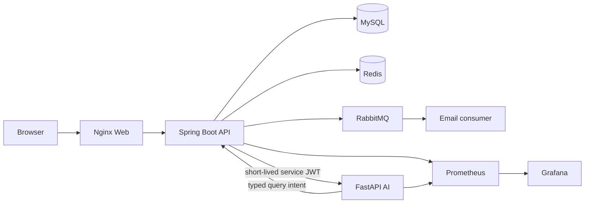
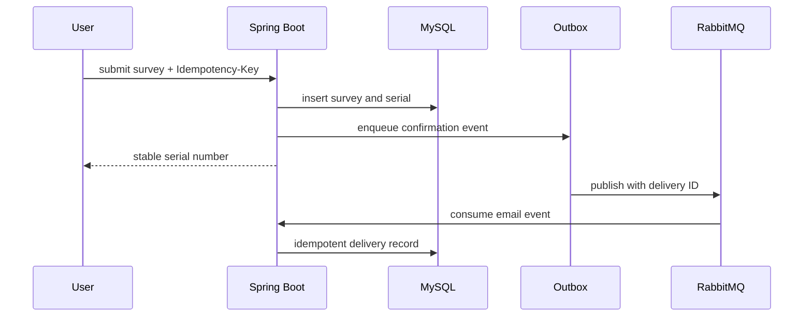
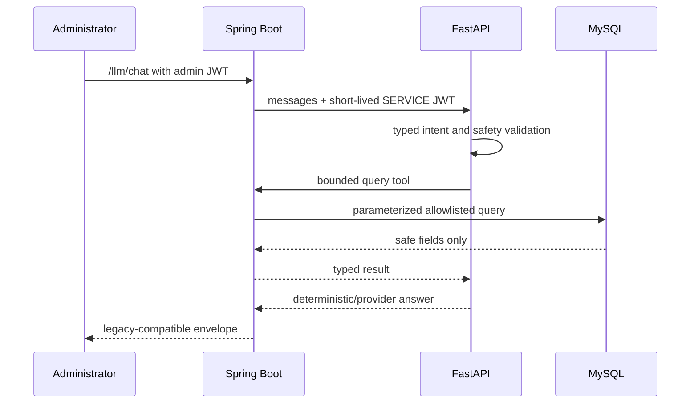

# FancyU｜高校交友匹配平台

FancyU（2026.05–2026.07）面向高校学生，支持校园邮箱验证、恋爱与交友问卷、匹配记录和联系方式授权。当前主分支为 **Spring Boot + FastAPI 重构版**，采用 MySQL、Flyway、Redis、RabbitMQ 和 Docker Compose。历史上线使用的 Node.js 版部署在阿里云 FC、RDS 和 OSS，源码已归档为 v1。 [v1 源码](https://github.com/JJJJCCCCCCC/fancyU/tree/v1) · [v1 ZIP](https://github.com/JJJJCCCCCCC/fancyU/archive/refs/heads/v1.zip)

## 工程亮点

- Java 21 + Spring Boot 3.5 模块化单体承载账号、问卷、序列号、匹配、投诉和后台。前端接口契约覆盖 **14 个静态页面**。
- Flyway 同时支持空库初始化和旧 MySQL 数据库原地升级，迁移测试验证数据保留。
- Spring Security + HS256 JWT + BCrypt；密码变更通过 `tokenVersion` 撤销旧令牌。
- Redis 存储 HMAC 后的验证码并执行原子消费和分布式限流。
- 通过 `Idempotency-Key`、数据库唯一约束和事务约束重复提交，问卷、序列号、幂等记录和通知事件一并落库。
- 联系方式仅在双方同意后返回；公开查询按 `display_self` 进行 fail-closed 过滤。
- Transactional outbox 发布 RabbitMQ 事件，邮件消费者按事件 ID 幂等投递。
- FastAPI 不持有数据库凭据，只能使用短时 `SERVICE` JWT 调用 Java 白名单查询工具。
- 管理员自然语言查询由 FastAPI 生成类型化意图，由 Java 执行参数化白名单查询。可交给外部模型的结果限定为允许的聚合数据，模型不可用时返回本地格式化结果。
- Java 与 FastAPI 暴露 Prometheus 指标，Grafana 和告警规则随 Compose 自动配置。
- GitHub Actions 执行 Java、Python、AI 评测、前端链接、Compose 和镜像构建检查。

## 架构



采用模块化单体是有意的工程选择：当前业务需要跨账号、问卷和匹配的强事务，
拆成多个业务微服务会增加分布式事务和部署成本。AI 编排服务单独部署，是因为其
依赖、扩缩容方式和安全边界与核心业务不同。

## 关键流程





## 目录

```text
.
|-- apps/
|   |-- api/                 # Java 核心业务 API
|   `-- ai-service/          # FastAPI AI 编排，无数据库凭据
|-- frontend/                # 静态页面、运行时 config.js、Nginx
|-- infra/
|   |-- prometheus/          # 抓取与告警规则
|   `-- grafana/             # 数据源和看板 provisioning
|-- scripts/                 # 前端和浏览器烟雾测试
|-- docs/
|   |-- contracts/           # 旧前端兼容契约
|   |-- deployment/          # 部署及上传清单
|   |-- demo/                # 面试演示脚本
|   `-- screenshots/         # 自动化验证截图
|-- fc-code/                 # 旧 Node 行为基线，不参与运行
|-- compose.yaml
`-- .env.compose.example
```

## 本地运行

要求：Docker Desktop、Docker Compose。

```powershell
Copy-Item .env.compose.example .env.compose
docker compose --profile local-db --env-file .env.compose up -d --build --wait
```

本机示例端口避开了 Windows 保留端口段：

| 服务 | 地址 |
|---|---|
| Web | `http://localhost:8280` |
| Java API | `http://localhost:8180/api/v1/system/health` |
| FastAPI | `http://localhost:8200/health` |
| Prometheus | `http://localhost:9090` |
| Grafana | `http://localhost:8400` |
| RabbitMQ 管理页 | `http://localhost:15672` |

`.env.compose.example` 仅含本地占位值。生产环境必须替换 JWT、数据库、RabbitMQ、
Grafana 管理员和 SMTP 凭据。升级旧环境时，`DATABASE_URL` 必须指向原生产
MySQL/RDS；示例中的 `mysql:3306` 只用于本地 Compose 数据库。

停止服务但保留数据：

```powershell
docker compose --profile local-db --env-file .env.compose down
```

不要在有真实数据的服务器上执行 `down -v`。

## 验证

Java：

```powershell
docker run --rm `
  -v "${PWD}/apps/api:/workspace" `
  -v sysudate-m2:/root/.m2 `
  -v /var/run/docker.sock:/var/run/docker.sock `
  -e TESTCONTAINERS_HOST_OVERRIDE=host.docker.internal `
  -w /workspace maven:3.9.9-eclipse-temurin-21 mvn test
```

AI：

```powershell
docker build --target test -t sysudate-ai-service:test apps/ai-service
```

前端：

```powershell
python scripts/check_frontend.py
python scripts/browser_smoke.py
```

最近一次本地证据：

- Java：clean 构建下 `45` 个非 Testcontainers 测试通过；Linux CI 运行包含 MySQL/Redis
  Testcontainers 的完整套件。
- AI：`22` 项 Python 测试通过；`11/11` 评测通过；`4/4`
  不安全请求被拦截。离线评测覆盖意图、参数与拦截。 [题集](apps/ai-service/eval/cases.json) · [报告](apps/ai-service/eval/report.json)
- 模型出站：24 个合成场景全部通过，捕获到敏感标记的场景从 **9/24 降至 0/24**。其中 12 项捕获到模型请求且保留预期聚合数据，其余 12 项未调用模型。 [出站实验与记录](docs/verification/outbound-privacy.md)
- Compose：MySQL、Redis、RabbitMQ、Java、FastAPI、Web、Prometheus、Grafana 全部 healthy。
- Chromium：在系统深色偏好下仍为浅色页面，主页可进入查询页，Dashboard 保留查询链接。
- Gitleaks：扫描源码和构建上下文，`no leaks found`。

## 安全与隐私

- 仓库不应包含 `.env.compose`、数据库导出、验证码、真实联系方式或生产令牌。
- FastAPI 永远不配置 MySQL 凭据；Java 查询工具排除邮箱、联系方式、照片和凭据。
- 外部模型只接收计数、匹配统计及性别/校区/年级分布；用户列表、个人详情和
  低基数敏感分组始终使用
  本地确定性格式化，不发送给第三方 Provider。
- 管理员接口和 `/llm/chat` 使用用户 JWT；内部 AI 工具只接受独立密钥签发且带
  `aud=sysudate-ai` 的短期 `SERVICE` JWT。
- 日志为结构化 JSON；通知日志不输出邮箱、验证码或事件 payload。
- `fc-code/` 仅用于兼容审计，不构建、不部署、不连接生产数据库。

