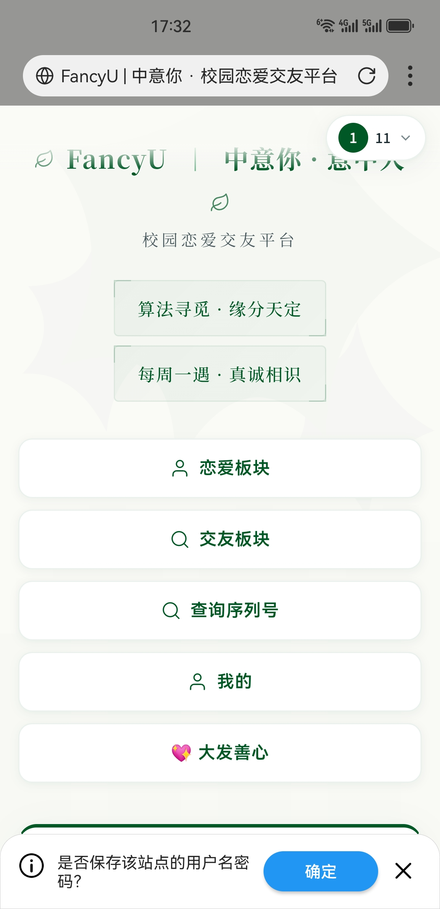
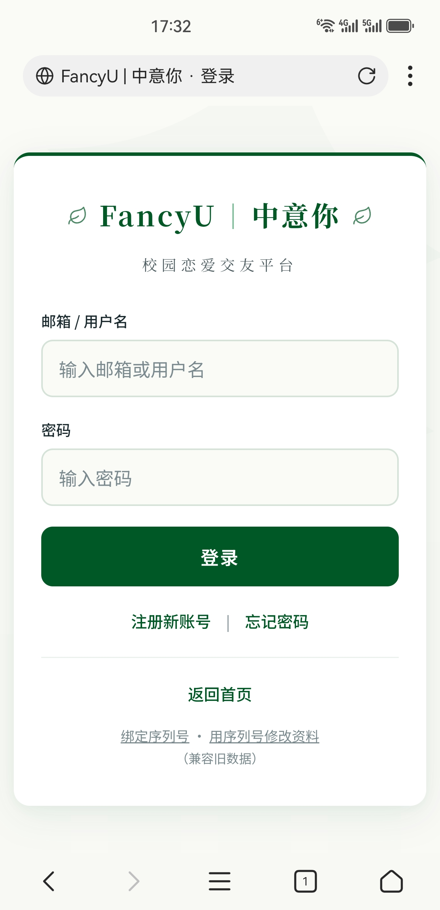
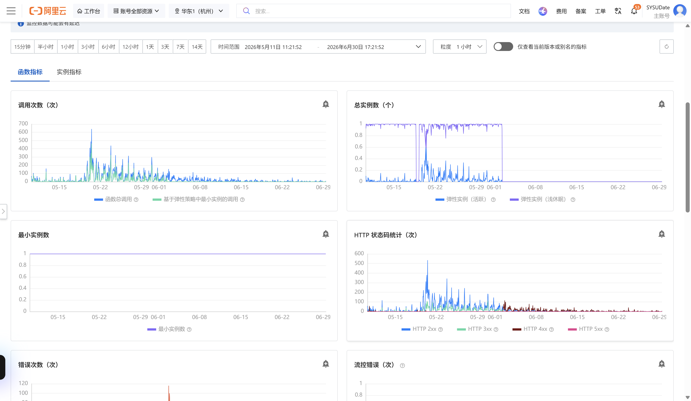

# SYSUDate（FancyU｜中意你）

一个面向高校学生的校园恋爱与交友匹配平台。项目曾部署在阿里云函数计算、RDS MySQL 与 OSS 上，完成了从邮箱注册、问卷填写、匹配到双方同意交换联系方式的完整业务闭环。

> 项目已结束持续运营，线上服务可能随时关闭。仓库保留可复现源码、数据库结构迁移和脱敏后的运行证据；真实用户数据库、联系方式、验证码及生产凭据不会公开。

## 项目成果

- 累计注册用户 1500+（统计与数据库原始证据仅在本地留存）。
- 完成注册、登录、双问卷、匹配、联系方式交换、投诉举报和后台管理流程。
- 在阿里云 FC、RDS、OSS 上完成真实部署并持续运行。
- 使用 JWT、bcrypt、参数化查询、接口限流和环境变量管理敏感配置。

## 系统架构

```text
浏览器
  └─ OSS：静态 HTML 页面
       └─ Function Compute：Node.js / Express API
            ├─ RDS MySQL：账号、问卷、匹配与投诉数据
            └─ SMTP：邮箱验证码和通知
```

## 核心功能

- 校园邮箱验证码注册与账号登录
- 序列号绑定及旧数据兼容
- 恋爱问卷与交友问卷
- 匹配参与开关、匹配记录和双向联系方式交换
- 个人资料及密码管理
- 投诉举报与管理员处理
- 管理后台用户检索、统计和对话记录
- LLM 辅助管理查询接口

## 技术栈

- 前端：原生 HTML、CSS、JavaScript
- 后端：Node.js、Express
- 数据库：MySQL 8.0、mysql2
- 认证与安全：JWT、bcryptjs、接口限流、参数化 SQL
- 邮件：Nodemailer、SMTP
- 云端：阿里云 Function Compute、RDS、OSS、VPC

## 目录结构

```text
.
├─ frontend/              # 静态前端页面
├─ fc-code/
│  ├─ index.js            # Express API 与业务逻辑
│  ├─ bootstrap           # 阿里云自定义运行时启动脚本
│  ├─ migration.sql       # 基础结构迁移
│  ├─ migration_v3.sql    # 后续结构迁移
│  ├─ package.json
│  └─ package-lock.json
└─ docs/
   ├─ EVIDENCE.md         # 展示材料说明
   └─ screenshots/        # 可公开的脱敏截图
```

## 本地启动后端

要求：Node.js 18+、MySQL 8.0。

```bash
cd fc-code
npm ci
```

复制 `.env.example` 中的变量到本地环境并填写测试值，然后执行数据库迁移：

```bash
mysql -u root -p your_test_database < migration.sql
mysql -u root -p your_test_database < migration_v3.sql
mysql -u root -p your_test_database < migration_v3_fix.sql
mysql -u root -p your_test_database < migration_v4.sql
node index.js
```

健康检查：

```text
GET http://localhost:9000/health
```

前端是静态页面，可由任意静态文件服务器托管。若要完整联调，需要把页面中的 API 地址调整为本地后端地址。

## 代表性接口

| 模块 | 接口示例 | 说明 |
|---|---|---|
| 账号 | `POST /account/register` | 邮箱验证码注册 |
| 账号 | `POST /account/login` | 邮箱或用户名登录 |
| 用户 | `GET /account/me` | 获取当前用户资料 |
| 问卷 | `POST /?action=submitSurvey` | 提交问卷 |
| 匹配 | `GET /account/matches` | 查询匹配记录 |
| 匹配 | `POST /account/exchange-contact` | 双方同意后交换联系方式 |
| 管理 | `GET /admin/stats` | 运营数据统计 |
| 投诉 | `POST /api/complaint` | 提交投诉举报 |
| 运维 | `GET /health` | 服务健康检查 |

## 展示与证据







更多截图及证据分类见 [docs/EVIDENCE.md](docs/EVIDENCE.md)。完整 Demo 视频、真实数据库导出和包含用户信息的原始材料仅作面试现场证明，不进入代码仓库。

## 项目状态

该项目已经完成开发、部署和真实用户验证。由于项目不再持续维护，后续可关闭线上 FC、RDS、OSS 与域名服务；这不会影响源码、演示视频和历史运行证据作为项目展示材料使用。

## 隐私与安全

- 仓库不包含真实 `.env`、数据库密码、SMTP 密码、JWT 密钥或管理员密码。
- 仓库不包含真实数据库导出、用户邮箱、联系方式、验证码和用户上传内容。
- `migration*.sql` 只描述数据库结构，不包含真实用户数据。
- 示例环境变量均为占位符，不能直接用于生产环境。

## 面试介绍建议

可以围绕四点展开：真实用户需求与产品闭环、Serverless 架构选择、身份认证和隐私安全、真实上线后的问题排查与运营证据。对外准确表述为“累计注册用户 1500+”，不要将其等同于日活或持续活跃用户。
