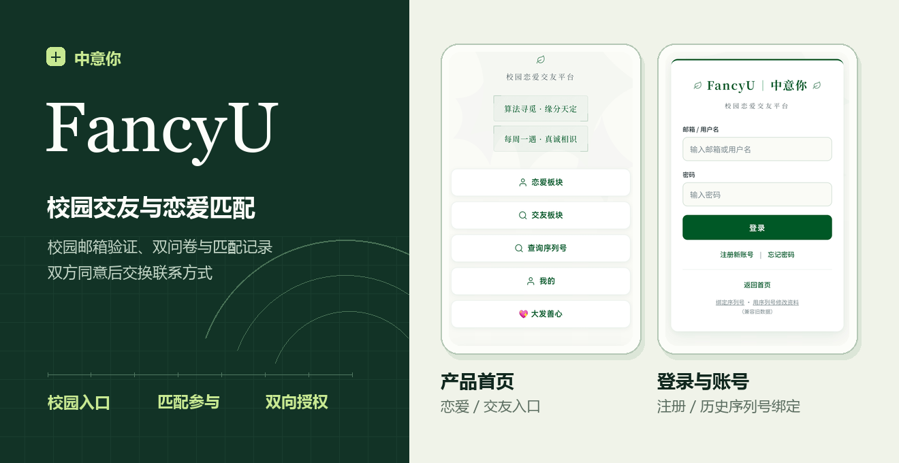
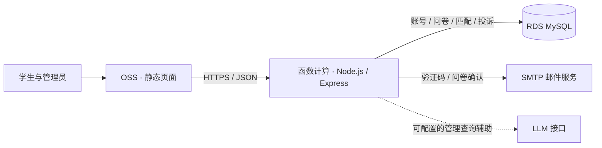
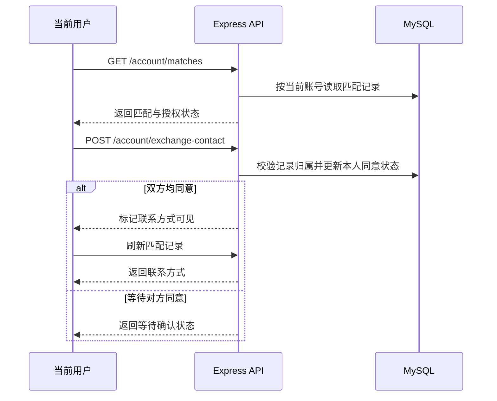
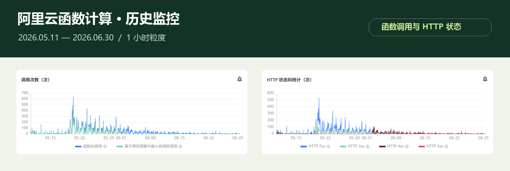

# FancyU · 中意你

**面向高校学生的校园交友与恋爱匹配平台。**

  

[产品流程](#product) · [公开版架构](#architecture) · [运行记录](#operations) · [工程化重构](#modernization) · [本地运行](#quickstart)



FancyU 将校园邮箱身份、恋爱与交友两条问卷流程、匹配记录和联系方式授权串成一套校园匹配应用。学生可独立选择参与哪类匹配，并在双方同意后查看联系方式。后台支持用户检索、投诉处理及运营统计。

本仓库的 `main` 保存曾部署在阿里云的 **Node.js 版本**。项目后来完成了一轮 Java 和 Python 工程化重构，其设计与验证结果见下文。

<a id="product"></a>

## 产品流程

| 阶段 | 主要能力 | 对应页面与接口 |
| --- | --- | --- |
| 校园身份验证 | 校园邮箱验证码注册、账号登录和密码重置，支持绑定旧版问卷序列号 | [注册](frontend/register.html) · [登录](frontend/login.html) · [绑定序列号](frontend/bind.html) |
| 问卷与参与 | 恋爱和交友问卷分别采集资料，用户可独立调整两类匹配参与状态 | [恋爱问卷](frontend/survey.html) · [交友问卷](frontend/friend_survey.html) · [个人中心](frontend/profile.html) |
| 匹配与授权 | 读取当前账号的匹配记录，对指定记录提交同意，双方同意后开放联系方式 | [用户中心](frontend/dashboard.html) · `GET /account/matches` · `POST /account/exchange-contact` |
| 后台运营 | 账号与问卷检索、投诉流转、统计查询，可配置 LLM 辅助管理查询 | [管理后台](frontend/admin.html) · `GET /admin/stats` · `POST /llm/chat` |

<a id="architecture"></a>

## 公开版架构

历史线上部署采用 **OSS 静态前端、阿里云函数计算运行 Express API、RDS MySQL 持久化**。前端通过 HTTP 与 API 交互。Express 在同一进程内处理账号认证、问卷写入、匹配记录、投诉和管理查询，并通过 SMTP 发送验证码与问卷确认邮件。



### 业务与数据边界

- **账号与旧数据兼容**。账号接口与根路径的历史问卷 `action` 接口并存。序列号可绑定到账号，也服务于旧流程的问卷查询和修改。
- **匹配授权**。服务端使用账号 JWT 读取归属当前账号的匹配记录。界面根据本人同意、对方同意与联系方式交换状态展示结果。
- **问卷持久化**。恋爱与交友问卷分流，提交时生成或沿用序列号。MySQL 迁移覆盖旧问卷结构、账号关联和后续字段调整。
- **管理入口**。独立管理员登录保护用户检索、投诉及运营统计接口。可选 LLM 查询从同一后台进入。



### 公开源码规模

以下数字来自 [公开源码快照 `47660d0`](https://github.com/JJJJCCCCCCC/fancyU/tree/47660d07fa9f940ce60ff9e5f221e6216933fd95)。

| 指标 | 数值 | 统计口径 |
| --- | ---: | --- |
| 静态页面 | **14** | [`frontend/`](frontend/) 下的 HTML 页面，覆盖用户端和管理端。 |
| Express 方法与路径声明 | **34** | [`fc-code/index.js`](fc-code/index.js) 中显式注册的路由，根路径的 `action` 子操作未重复计算。 |
| MySQL 迁移脚本 | **4** | [`fc-code/`](fc-code/) 下的版本化 SQL 文件。 |
| 应用与迁移源码 | **17,202 行** | HTML（含内联样式和脚本）14,419 行，API 2,535 行，SQL 248 行。按物理行统计，含注释和空行。 |

<a id="operations"></a>

## 历史运行记录

据项目留存的历史注册汇总，平台曾累计注册 **1,500+ 账号**。下图摘自阿里云函数计算监控，展示 **2026 年 5 月 11 日至 6 月 30 日** 的函数调用和 HTTP 状态，采样粒度为一小时。



移动端截图和监控图均取自历史留存材料。更多部署与运行资料见 [证据索引](docs/EVIDENCE.md)。

<a id="modernization"></a>

## 后续工程化重构

以下为独立维护的本地重构版本，聚焦旧数据兼容、事务一致性、异步通知与可复现交付。`main` 的运行命令仍适用于本仓库的 Node.js 版本。

| 工程问题 | 重构实现 |
| --- | --- |
| 旧库迁移与重复提交 | Java 21 / Spring Boot 模块化单体；Flyway 兼容旧库升级与空库初始化；问卷、序列号和通知事件在同一事务内持久化，并用 `Idempotency-Key` 约束重复提交。 |
| 身份、隐私与通信 | Spring Security、JWT 和 BCrypt 管理身份；Redis 保存 HMAC 后的验证码并原子消费；公开资料按授权字段返回；Transactional Outbox 将确认邮件交给 RabbitMQ，消费者按事件 ID 去重。 |
| 受限的管理查询 | FastAPI 将自然语言转为类型化意图，使用短时服务令牌调用 Java 白名单查询；数据访问与字段限制留在 Java 侧。 |
| 交付与观测 | Docker Compose 编排应用和基础设施；Prometheus / Grafana 配置随项目交付；本地工程配置了 Java、Python、前端检查与容器烟雾测试的 CI 工作流。 |

本地重构源码包含 **54 个 Java 主源码文件和 10 个 FastAPI 应用 Python 文件**。本次重新运行本地离线 AI 评测，**11/11 用例通过**，其中 **4/4 不安全请求被拦截**，评测记录中的敏感字段泄漏数为 **0**。

<a id="quickstart"></a>

## 本地运行公开版

需要 Git、Node.js 22+ 和 npm。以下命令使用 Bash。

```bash
git clone https://github.com/JJJJCCCCCCC/fancyU.git
cd fancyU
cp -n .env.example .env
```

在 [`.env.example`](.env.example) 对应配置中，为本地环境填写 `MYSQL_HOST`、`MYSQL_USER`、`MYSQL_PASSWORD`、`JWT_SECRET` 和 `ADMIN_PASSWORD`。验证邮件或 LLM 功能时，再配置测试 SMTP 或 `LLM_API_URL`。PowerShell 可使用 `Copy-Item .env.example .env` 复制模板。

```bash
cd fc-code
npm ci
node --check index.js
node --env-file=../.env index.js
```

在另一个终端运行 `curl -fsS http://127.0.0.1:9000/health`。返回 `status: ok` 代表应用进程在线。业务接口联调需要可连接的 MySQL 8.0 测试库。

<details>
<summary>MySQL 迁移与前端联调</summary>

1. 准备与旧版兼容的测试库和合成数据。公开版迁移依赖已有 `users` 等旧表。按 [基础迁移](fc-code/migration.sql)、[v3](fc-code/migration_v3.sql)、[v3 修正](fc-code/migration_v3_fix.sql)、[v4](fc-code/migration_v4.sql) 的顺序审阅并应用当前测试库缺少的迁移。
2. 将要联调的前端页面的 API 地址指向 `http://127.0.0.1:9000`。回到仓库根目录，用 Python 3 启动静态服务。

   ```bash
   python -m http.server 8080 --bind 127.0.0.1 --directory frontend
   ```

3. 打开 [本地首页](http://127.0.0.1:8080/)，按注册或登录、问卷提交、匹配记录、同意交换的顺序验证。测试联系方式时覆盖单方同意和双方同意两种状态。
4. 调用 API 时同时检查 HTTP 状态和 JSON 中的 `code`。部分业务错误通过响应体返回。

</details>

## 仓库导览

| 路径 | 内容 |
| --- | --- |
| [`frontend/`](frontend/) | 静态产品页面、问卷、用户中心与管理后台。 |
| [`fc-code/index.js`](fc-code/index.js) | Express 路由、业务逻辑、数据库访问、邮件与管理查询。 |
| [`fc-code/`](fc-code/) | 依赖锁定、MySQL 迁移与函数计算启动脚本。 |
| [`docs/EVIDENCE.md`](docs/EVIDENCE.md) | 历史产品页面、部署与运行截图索引。 |
| [`upload_frontend.sh`](upload_frontend.sh) | 历史 OSS 部署脚本。 |

反馈问题时，可附操作系统、Node.js 版本、最小复现步骤和实际结果。涉及账号、问卷或匹配的示例请使用合成数据。

## 许可

本仓库当前没有声明项目许可证。第三方依赖遵循各自的许可证。
